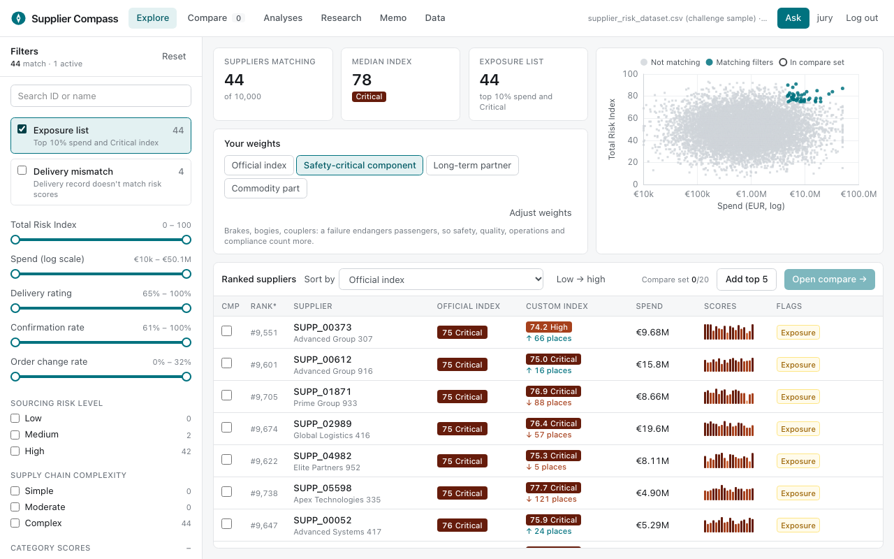
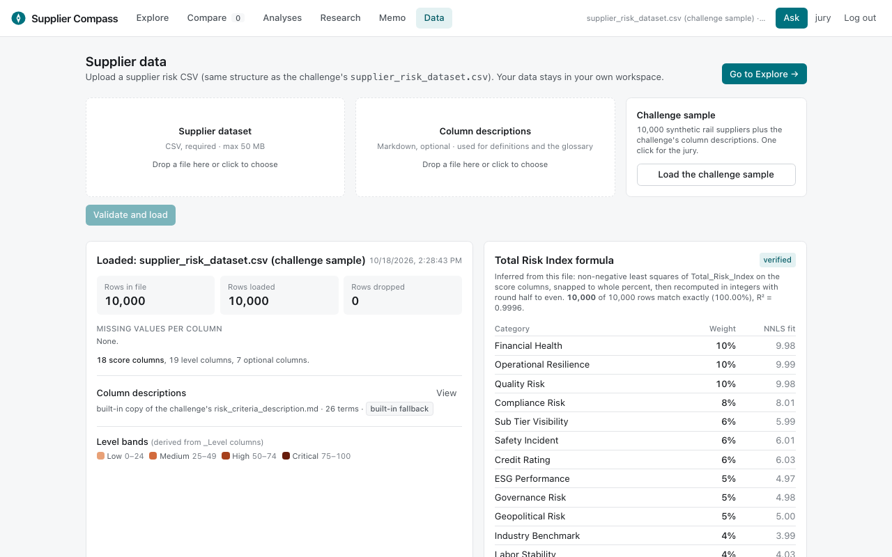
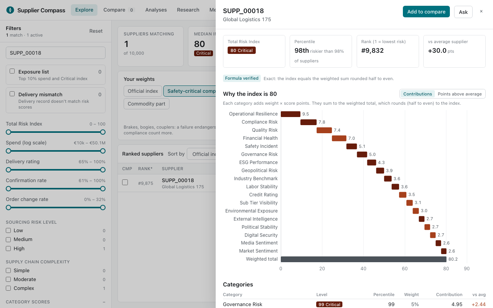
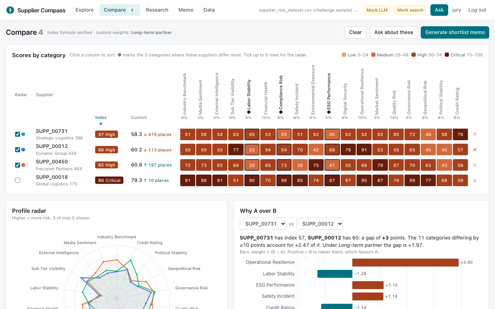
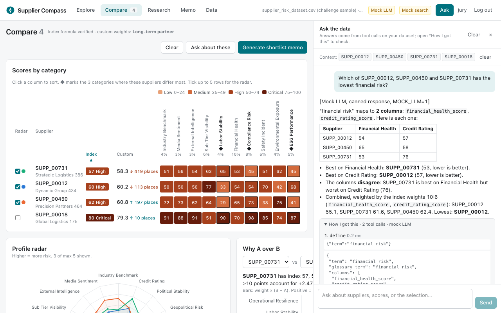
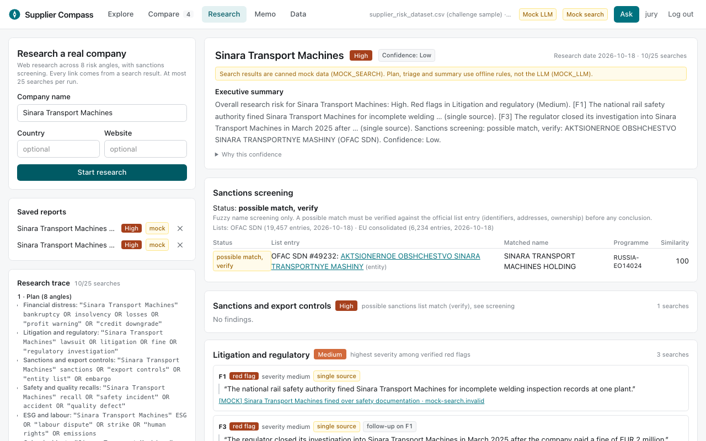
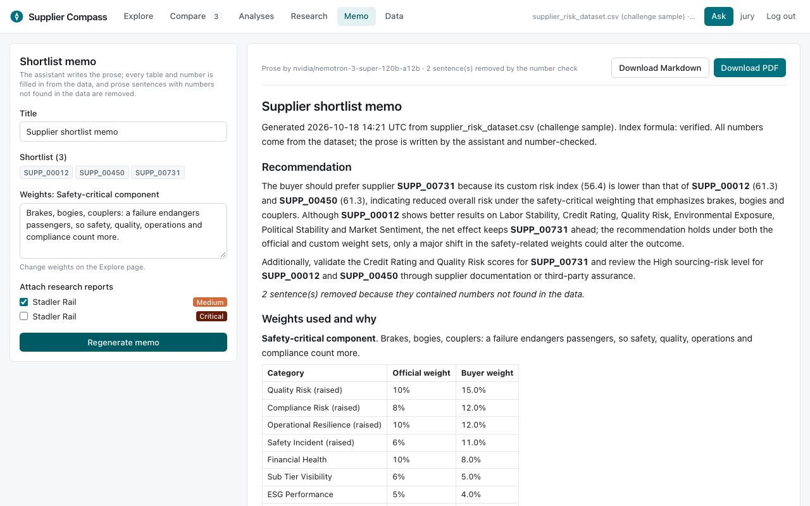

# Supplier Compass

A web app for the Siemens **Smart Supplier Selection for Trains** challenge. A rail procurement buyer uses it to
narrow 10,000 suppliers down to a justified choice: filter, rank, compare up to 20 side by side, ask questions
in plain language, research a real company, and export a shortlist memo.

Every number shown comes from the dataset (through a computation or a logged tool call). Every claim from the
web carries a source link returned by a search tool.



- [Run locally](#run-locally)
- [Run with Docker](#run-with-docker)
- [Deploy on a Nebius VM](#deploy-on-a-nebius-vm)
- [Jury logins](#jury-logins)
- [How the brief is met](#how-the-brief-is-met)
- [Two-minute demo script](#two-minute-demo-script)
- [Tests](#tests)
- [Design decisions](#design-decisions)

## Run locally

Requirements: Python 3.11+ (tested on 3.12 in Docker and 3.14 locally) and Node 20+. No GPU is needed anywhere.

```bash
python3 -m venv .venv
.venv/bin/pip install -r backend/requirements-dev.txt
.venv/bin/python scripts/download_sanctions.py        # OFAC SDN + EU lists → data/sanctions/ (about 12 MB)

cd frontend && npm ci && npm run build && cd ..        # builds frontend/dist, served by the backend

cp .env.example .env                                   # then edit: APP_USERS, SECRET_KEY, keys
cd backend
set -a; . ../.env; set +a
../.venv/bin/uvicorn app.main:app --port 8000
```

Open <http://localhost:8000>, sign in, and click **Load the challenge sample**.

**Keys.** Chat and memo prose need `LLM_API_KEY`; company research needs `TAVILY_API_KEY` and `LLM_API_KEY`.
Without them the header shows "LLM not configured" / "Search not configured", the chat answers with a
not-configured error, and the memo falls back to prose generated from the data only. Explore, Compare and the
supplier drawer need no keys.

**Frontend dev server** (hot reload; proxies `/api` to :8000): `cd frontend && npm run dev`, then open :5173.

## Run with Docker

```bash
cp .env.example .env      # set APP_USERS, SECRET_KEY, LLM_API_KEY, TAVILY_API_KEY
docker compose up -d --build
```

One image: a Node stage builds the frontend, then a Python 3.12 slim image serves it with the API on port 8000.
The sanctions lists are downloaded **at build time** and cached in the image. If the download fails, the build
still succeeds and the app reports the lists as unavailable. User datasets and research reports live in the
`app-data` volume (`/data`). Set `PORT` in `.env` to publish on a port other than 8000.

## Deploy on a Nebius VM

The app is CPU-only and small: one container, about 165 MB resident memory with the sample loaded (measured locally).

1. **Create the VM** in the Nebius AI Cloud console: Ubuntu 22.04 or 24.04, a CPU-only platform with 2–4 vCPUs and 4–8 GB RAM, a 30 GB boot disk, a public IPv4 address, and your SSH key.
2. **Open ports** 22, 80 and 443 in the VM's security group (or only 8000 for a quick test).
3. **Install Docker** on the VM:
   ```bash
   ssh <user>@<vm-ip>
   curl -fsSL https://get.docker.com | sudo sh
   sudo usermod -aG docker $USER && newgrp docker
   ```
4. **Deploy**:
   ```bash
   git clone <this repo> supplier-compass && cd supplier-compass
   cp .env.example .env && nano .env      # APP_USERS, SECRET_KEY, LLM_API_KEY (Nebius Token Factory), TAVILY_API_KEY
   docker compose up -d --build
   ```
   The app is now at `http://<vm-ip>:8000`.
5. **HTTPS (recommended for the jury).** Point a DNS name at the VM, set `COOKIE_SECURE=1` in `.env`, and put
   Caddy in front ([install guide](https://caddyserver.com/docs/install)). It fetches certificates automatically: 
   ```bash
   # after installing Caddy:
   echo 'compass.example.com {
     reverse_proxy 127.0.0.1:8000
   }' | sudo tee /etc/caddy/Caddyfile && sudo systemctl reload caddy
   docker compose up -d
   ```
   Then close port 8000 in the security group.
6. **Update** with `git pull && docker compose up -d --build`. Data persists in the `app-data` volume.

Create the LLM key in Nebius Token Factory. The default endpoint is
`https://api.tokenfactory.nebius.com/v1/` and the default model is `nvidia/nemotron-3-super-120b-a12b`.
Any OpenAI-compatible endpoint and tool-calling model works via `LLM_BASE_URL` and `LLM_MODEL`.
`LLM_FAST_MODEL` (optional) is used for the research agent's planning, triage and summaries.

## Jury logins

Users come from one environment variable: `APP_USERS="jury:<password>,alice:<password2>"`. Passwords are
hashed (PBKDF2-SHA256, random salt) at startup and the plain text is not kept. The session is a signed,
HTTP-only, SameSite=Lax cookie (12 hours), signed with `SECRET_KEY`. Set `SECRET_KEY` explicitly so sessions
survive restarts. Every `/api` route except `/api/login` requires a session. Each user has their own dataset
and research reports under `DATA_DIR/<user>/`, so two users never see each other's data. Jurors who share
one login share its dataset; give each juror their own name if they should not.

## Configuration

| Variable | Default | Purpose |
|---|---|---|
| `APP_USERS` | `jury:jury` | `name:password` pairs, comma-separated |
| `SECRET_KEY` | random at startup | signs session cookies |
| `COOKIE_SECURE` | `0` | `1` behind HTTPS |
| `LLM_BASE_URL` | Nebius Token Factory | OpenAI-compatible endpoint |
| `LLM_API_KEY` | (empty) | required for chat, research and memo prose |
| `LLM_MODEL` | `nvidia/nemotron-3-super-120b-a12b` | chat and memo model (needs tool calling) |
| `LLM_FAST_MODEL` | `LLM_MODEL` | research planning, triage and summary |
| `TAVILY_API_KEY` | (empty) | required for research (web search and extraction) |
| `DATA_DIR` | `./var` (Docker: `/data`) | per-user DuckDB files and reports |

## How the brief is met

### Inputs and upload



| Requirement | Where |
|---|---|
| Upload page with CSV and Markdown drop zones, "Load the challenge sample" | `frontend/src/pages/Upload.tsx`, sample in `data/sample/` |
| 50 MB limit, streamed to a temp file, DuckDB `read_csv` with a 10 s timeout (`con.interrupt`) | `backend/app/main.py` `upload`, `backend/app/dataset.py` `_load` |
| Validation: required columns, scores numeric 0–100, unique IDs, missing values per column, dropped rows with reasons and examples | `dataset.py` (row reasons are computed in SQL), shown in the report on the Upload page |
| Extra columns allowed and listed; missing optional columns turn off the features that need them, with a notice | `FEATURES` in `dataset.py`; the UI reads `features` |
| Per-user DuckDB file `DATA_DIR/<user>/dataset.duckdb`, replace asks for confirmation (409 without it), temp files deleted | `Registry` in `dataset.py`, confirmation modal in `Upload.tsx` |
| Untrusted contents: React escapes all text; no cell value ever reaches SQL text (the path is a bound parameter, identifiers are sanitised to `[a-z0-9_]`); Markdown is shown as plain text and rendered by a React-element renderer that never uses `innerHTML` | `dataset.py`, `components/Markdown.tsx` |
| Column descriptions: parsed from the uploaded Markdown, or the built-in copy labelled "built-in fallback" | `backend/app/descriptions.py` |
| Stored metadata: file name, upload time, row count, validation report, inferred weights | `meta` table in each DuckDB file |

### Index weights, inferred per dataset

1. NNLS of `Total_Risk_Index` on all `*_Score` columns, no intercept (`scipy.optimize.nnls`).
2. Snapped to whole percent by largest remainder, so the weights sum to exactly 100.
3. Recomputed in integers, Σ(weight% × score) / 100 with **round half to even**, and the exact-match share is recorded.
4. ≥ 99% exact → **verified**. Otherwise **approximate (R² = …)**, and every explanation in the UI and chat says so.
5. Weights and the verification result are shown on the Upload page and in the supplier drawer.

The bundled sample comes out **verified on 10,000 / 10,000 rows** with exactly 10/10/10/8/6/6/6/5/5/5/4/4/4/4/4/3/3/3 %
(`tests/test_index.py`). Half-up rounding would fail on 47 rows, which a test also checks. Level bands are
derived as min/max score per `_Level` label, with a fallback to 0–24 / 25–49 / 50–74 / 75–100.
Code: `backend/app/index_model.py`.

### Explore

| Requirement | Where |
|---|---|
| Derived fields: percentiles, contributions (weight × score), points above average (weight × (score − mean)), exposure (index/100 × spend), delivery-mismatch flag (residual of delivery rating on Operational_Resilience + Quality_Risk, \|r\| > 2 sd) | `Dataset._derive`, `contributions`, `mismatch_info` in `dataset.py` |
| Buyer weights with the four presets; the custom index is always labelled next to the official one; rank changes ("↑ 12 places"); the official index is never overwritten | `backend/app/weights.py`, `components/WeightsBar.tsx` |
| Filter panel: a slider per score, index, spend (log), delivery, confirmation, change rate; Sourcing Risk Level and Supply Chain Complexity checkboxes; "Exposure list" and "Delivery mismatch" toggles; live counts per option | `pages/Explore.tsx`, `lib/filter.ts` |
| Ranked, virtualised list: ID, name, official and custom index with level chips, spend, mini bar of the 18 scores, compare checkbox (max 20) | `SupplierList` in `Explore.tsx` (`@tanstack/react-virtual`) |
| Summary tiles (matching, median index, exposure count) and an index-vs-spend scatter (log x) with the filter highlighted and the compare set ringed | `Explore.tsx` |

### Supplier drawer



Index waterfall (contributions sorted, then the weighted total that rounds to the index), points above average,
level and percentile per category, operational metrics with percentiles, and the mismatch flag explained in
words ("suppliers like this deliver about 81.0%; this one delivers 76.9%…"). `components/SupplierDrawer.tsx`.

### Compare



A heatmap of suppliers × 18 categories, coloured by level band with the score in each cell, sortable by any
column, with the 3 most different categories (highest spread) marked ◆. A radar for up to 5 ticked suppliers.
"Why A over B" lists only categories differing by ≥ 10 points, with weight × (B − A) under official and custom
weights. Operational metrics side by side. "Ask about these" and "Generate shortlist memo" buttons.
`pages/Compare.tsx`, `backend/app/compare.py`.

### Chatbot



Tool-calling loop (`backend/app/chat.py`, tools in `backend/app/tools.py`):
`get_suppliers`, `query_suppliers` (sqlglot-parsed single SELECT on `suppliers` only, LIMIT ≤ 200, 2 s timeout,
run on a private in-memory DuckDB copy with external access disabled and the configuration locked),
`explain_index`, `compare` (reports the best and worst supplier per column, whether the columns disagree, and the
index-weighted combination), `define` (descriptions file plus an everyday-term glossary, e.g. "financial risk" →
Financial_Health and Credit_Rating), `make_chart` (ECharts options built server-side from dataset values; bar,
radar, heatmap and scatter only) and `add_to_compare` (a UI button).

- The model is told never to state numbers from memory. If an answer has numbers but no tool call, the model is
  sent back once to use tools. If it still has none, the answer is marked "not verified against the dataset".
- **How I got this** expands every tool call with its arguments, the executed SQL and the rows used.
- Nemotron's inline `<TOOLCALL>[…]</TOOLCALL>` format is parsed as well as native `tool_calls`.
- Test cases from the brief: SUPP_00731 is best on Financial_Health but worst on Credit_Rating; combined 10:6,
  SUPP_00012 is lowest (55.1 vs 61.6 / 62.4). SUPP_00018 → 80, Critical, 98th percentile, drivers
  Operational_Resilience +4.5, Compliance +3.8, Governance +2.4.

### Research agent



`backend/app/research.py`, streamed over SSE (`GET /api/research/stream`):

1. **Plan**: one query per fixed angle (financial distress, litigation and regulatory, sanctions and export
   controls, safety and quality recalls, ESG and labour, cyber, supply disruption, ownership and leadership).
2. **Search**: Tavily `/search` per angle, then `/extract` full text for the top pages.
3. **Triage**: red flag / neutral / positive with category and severity. The quote must appear **verbatim** in
   the fetched text, otherwise the finding is rejected as a misquote.
4. **Dig deeper**: up to 2 follow-up searches per red flag (who, when, outcome), nested in the trace. Hard budget
   of 25 searches per run.
5. **Sanctions**: fuzzy match (RapidFuzz, legal suffixes stripped) against the OFAC SDN (with aliases) and EU
   consolidated lists from `scripts/download_sanctions.py`. Results are only ever "possible match, verify",
   with the list entry and link.
6. **Verify**: claims without a source URL, or whose URL no search returned, are dropped. Single-source claims
   are marked; corroboration needs a second domain.
7. **Report**: executive summary (a summary citing a non-existent finding is replaced by a template), risk level
   per category in the dataset's band style with evidence quotes and links, searched-without-findings, sanctions,
   confidence with reasons, and the research date. Reports are saved per user and can be attached to the memo.

### Shortlist memo



`backend/app/memo.py`. Built from the compare set: the buyer's weights and reason, a ranked shortlist (official
and custom index), key differences (most different categories, plus why #1 over #2), risks to mitigate (High
and Critical drivers, exposure, delivery mismatch, hard-to-replace suppliers) and attached research. All tables
and numbers are generated from data. The LLM writes only the recommendation paragraphs, and a **number check**
removes any sentence whose numbers are not facts about the suppliers, categories or companies it names
(e.g. "SUPP_00012 is 99 times safer" is removed). Export as Markdown or PDF (fpdf2).

### Design

Light theme with one petrol accent (`#00727f`). Level colours are a single-hue ramp from light to dark
(Low `#e8a177` → Critical `#661c0b`), checked with an ordinal-palette validator, and always shown with a
text label. Tabular numerals throughout, a 15 px base font, and layouts checked at 1280 × 800
(the screenshots above).

## Two-minute demo script

| Time | Action | Say |
|---|---|---|
| 0:00 | Sign in. Click **Load the challenge sample**. | "Upload any supplier file; it's validated first. The app reverse-engineers the risk formula: verified on 10,000 of 10,000 rows, these weights." |
| 0:15 | Go to **Explore**. Toggle **Exposure list**. | "44 suppliers are in the top 10% by spend and Critical: that's where the money is at risk." Point at the scatter. |
| 0:30 | Click **Safety-critical component**. | "For brake parts I weight safety and quality up. Custom index next to the official one; see who moves: ↑ 66 places." |
| 0:45 | Search SUPP_00018, open the drawer. | "Why 80? Waterfall: Operational Resilience +4.5, Compliance +3.8, Governance +2.4 points above average. Exact, not a guess." |
| 1:00 | Tick 3 suppliers, open **Compare**. | "Heatmap with the three categories where they differ most. Why A over B: only differences of 10+ points, with their effect on the index." |
| 1:15 | **Ask about these**: "Which of SUPP_00012, SUPP_00450 and SUPP_00731 has the lowest financial risk?" | "'Financial risk' is two columns, and they disagree. It shows both and the weighted combination. Open *How I got this*: the tool calls and rows." |
| 1:35 | **Research**: type a real rail supplier and start. | "Eight angles, follow-ups on red flags, sanctions screening, every quote verbatim with its link. Unsourced claims are dropped." |
| 1:50 | **Memo** → attach the report → Generate → **Download PDF**. | "A shortlist memo: numbers filled in from data, prose number-checked. Ready to send." |

## Tests

```bash
cd backend && ../.venv/bin/python -m pytest          # 64 tests
cd frontend && npx tsc -b                            # type-check
cd frontend && npm run build && npx playwright test  # smoke test (starts the backend and a test-only fake LLM)
```

Backend tests cover: index reconstruction for every row, the exact weights and the "verified" status, rounding
ties, level bands and the fallback, the approximate case; upload validation, size limit, replace confirmation,
user isolation and the Markdown fallback; the SQL guard (INSERT/UPDATE/DELETE/DDL, multiple statements, other
tables, table functions, file access, LIMIT); explain_index for SUPP_00018; the financial-risk ambiguity with
a scripted LLM; the tool loop with a scripted LLM (including a rejected query and the "no tools" challenge); the
research agent against a faked Tavily HTTP API (plan, follow-up on a red flag, the 25-search budget, verification
dropping unsourced and misquoted claims, single-source marking, sanctions possible-match); the memo number check
and PDF export; and auth on every `/api` route.

The Playwright smoke test logs in, loads the sample, filters to the exposure list, adds 3 suppliers to
compare, opens Compare, asks a question (answered by a test-only fake LLM through the real tool loop) and checks the trace, then generates and downloads the memo.

## Design decisions

- **Per-user data, not per-session.** Each user name gets its own DuckDB file, so a juror who logs in again
  keeps their dataset. Separate users never share data.
- **Filtering happens in the browser.** The backend computes every derived field and the custom index; the
  browser receives all 10,000 rows once (about 460 KB gzipped) and filters them with no network round-trip.
- **Ranks are competition ranks on the integer index** (1 = lowest risk, ties share a rank). The custom index is
  ranked on its unrounded value. With the official weights it equals the official index exactly.
- **Presets multiply** the official weights of their categories (e.g. Safety × 2.5), then renormalise to 100%.
- **The compare heatmap is an HTML grid**, not a canvas chart. That gives sortable headers, readable numbers in
  every cell and keyboard access. All other charts are ECharts.
- **No mock modes in the app.** Missing keys produce explicit "not configured" errors; the fakes used by the
  tests (`backend/tests/fakes.py`, `frontend/e2e/fake_llm.py`) are test-only.
